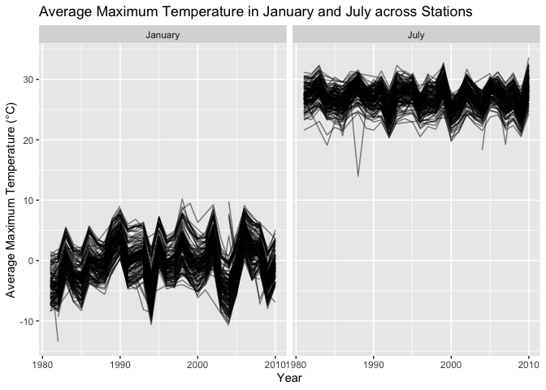
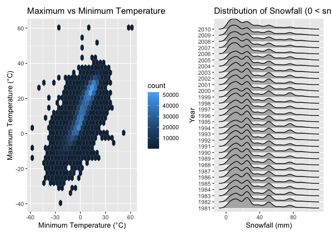
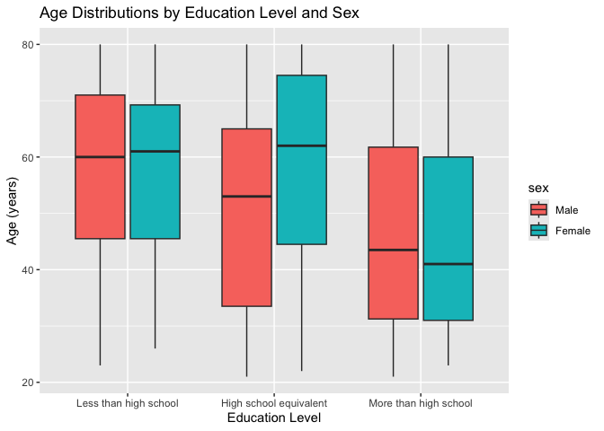
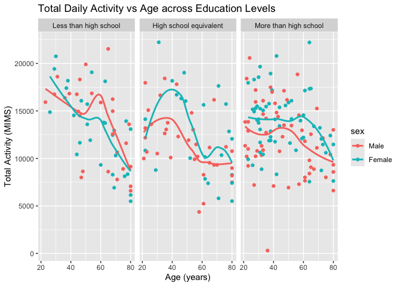
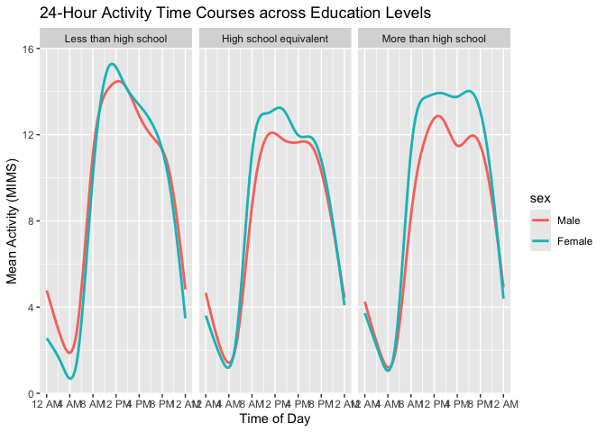
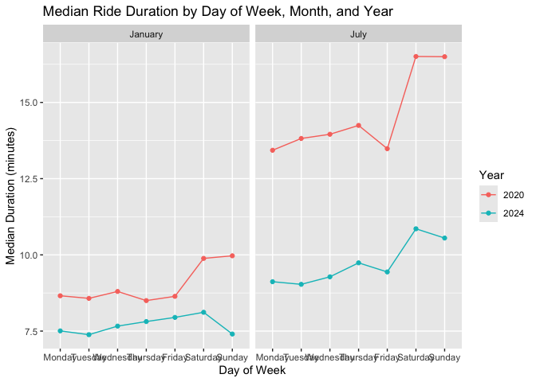
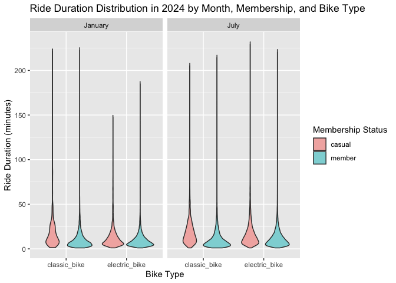

p8105_hw3_yw4854.Rmd
================
Yuxuan Wang
2026-10-19

## Problem 1

### Do some data cleaning. Create separate variables for year, month, and day. Ensure observations for temperature, precipitation, and snowfall are given in reasonable units. For snowfall, what are the most commonly observed values? Why?

``` r
data("ny_noaa")

ny_noaa_clean = ny_noaa %>% 
  separate(date, into = c("year", "month", "day"), sep = "-", convert = TRUE) %>% 
  mutate(
    tmax = as.numeric(tmax) / 10,
    tmin = as.numeric(tmin) / 10,
    prcp = prcp / 10
  )

snow_counts = ny_noaa_clean %>% 
  count(snow, sort = TRUE)
```

For snowfall, the most commonly observed value is 0. This is because for
most days of the year in New York, it does not snow at all, as snow only
falls during winter months. Besides 0, NA (missing value) is also very
common because many weather stations did not record snowfall data every
day.

The `ny_noaa` dataset contains 2595176 observations and 7 variables. Key
variables include weather station ID (`id`), date of observation
(`date`), precipitation (`prcp`), snowfall (`snow`), snow depth
(`snwd`), and temperature bounds (`tmax`, `tmin`). Missing data is a
substantial issue: both `tmax` and `tmin` are missing in nearly 44% of
records, and `snow` has 381221 missing values.

### Make a two-panel plot showing the average max temperature in January and in July in each station across years. Is there any observable / interpretable structure? Any outliers?

``` r
jan_july_df = ny_noaa_clean %>% 
  filter(month %in% c(1, 7)) %>% 
  group_by(id, year, month) %>% 
  summarize(mean_tmax = mean(tmax, na.rm = TRUE), .groups = "drop") %>% 
  mutate(month = ifelse(month == 1, "January", "July"))

ggplot(jan_july_df, aes(x = year, y = mean_tmax, group = id)) +
  geom_line(alpha = 0.5) +
  facet_grid(. ~ month) +
  labs(
    title = "Average Maximum Temperature in January and July across Stations",
    x = "Year",
    y = "Average Maximum Temperature (°C)"
  )
```

<!-- --> From
the plot, we can see a clear seasonal structure: the average maximum
temperatures in July are mostly between 25°C and 30°C, while in January
they are much lower, generally between -10°C and 10°C. Also, the
temperature in January shows larger year-to-year variation than in July.

There are also some outliers. For example, in January around 1982, one
station had an unusually cold average temperature below -14°C. In July
around 1988, there was another outlier where one station had a very low
average temperature around 14°C, which is far lower than other stations.

### Make a two-panel plot showing (i) tmax vs tmin for the full dataset (note that a scatterplot may not be the best option); and (ii) make a plot showing the distribution of snowfall values greater than 0 and less than 100 separately by year.

``` r
plot_tmax_tmin = ggplot(ny_noaa_clean, aes(x = tmin, y = tmax)) +
  geom_hex() +
  labs(
    title = "Maximum vs Minimum Temperature",
    x = "Minimum Temperature (°C)",
    y = "Maximum Temperature (°C)"
  )

plot_snow = ny_noaa_clean %>% 
  filter(snow > 0, snow < 100) %>% 
  mutate(year = as.factor(year)) %>% 
  ggplot(aes(x = snow, y = year)) +
  geom_density_ridges() +
  labs(
    title = "Distribution of Snowfall (0 < snow < 100 mm) by Year",
    x = "Snowfall (mm)",
    y = "Year"
  )

plot_tmax_tmin + plot_snow
```

<!-- --> From
the two-panel plot, we can see two main patterns.

First, for the temperature plot on the left, minimum and maximum
temperatures show a strong positive correlation, meaning higher minimum
temperatures generally correspond to higher maximum temperatures. Since
the dataset is very large, using a hexagonal heatmap helps avoid
overplotting, showing that most data points are concentrated in the
central area.

Second, for the snowfall plot on the right, the distribution of snowfall
between 0 and 100 mm is fairly consistent across different years. Most
snowfall values are between 0 and 35 mm, with visible peaks around 13
mm, 25 mm, and 50 mm, which likely come from converting standard
imperial units (half-inch, one-inch, and two-inch) into metric
measurements.

## Problem 2

### Data Tidying

``` r
covar_df = read_csv("data/nhanes_covar.csv", skip = 4) %>% 
  janitor::clean_names() %>% 
  filter(age >= 21) %>% 
  drop_na(sex, age, bmi, education) %>% 
  mutate(
    sex = factor(sex, levels = c(1, 2), labels = c("Male", "Female")),
    education = factor(
      education,
      levels = c(1, 2, 3),
      labels = c("Less than high school", "High school equivalent", "More than high school")
    )
  )

accel_df = read_csv("data/nhanes_accel.csv") %>% 
  janitor::clean_names()

mims_df = inner_join(covar_df, accel_df, by = "seqn")
```

### Education and Sex Distribution

``` r
mims_df %>% 
  count(education, sex) %>% 
  pivot_wider(names_from = sex, values_from = n) %>% 
  knitr::kable(
    caption = "Number of Men and Women in Each Education Category",
    col.names = c("Education Level", "Male", "Female")
  )
```

| Education Level        | Male | Female |
|:-----------------------|-----:|-------:|
| Less than high school  |   27 |     28 |
| High school equivalent |   35 |     23 |
| More than high school  |   56 |     59 |

Number of Men and Women in Each Education Category

``` r
ggplot(mims_df, aes(x = education, y = age, fill = sex)) +
  geom_boxplot() +
  labs(
    title = "Age Distributions by Education Level and Sex",
    x = "Education Level",
    y = "Age (years)"
  )
```

<!-- --> From
the table, the sample size across education categories is fairly
balanced between males and females. The “More than high school” group
has the largest number of participants for both men and women, while the
“High school equivalent” and “Less than high school” groups have fewer
participants.

From the boxplot, we can see that participants with higher education
(“More than high school”) are generally younger compared to the other
two categories. In contrast, participants with “Less than high school”
education are mostly older, with median ages around 60 for both males
and females. In addition, within the “High school equivalent” group,
female participants appear to be slightly older than male participants
on average.

### Total Daily Activity vs Age

``` r
total_activity_df = mims_df %>% 
  rowwise() %>% 
  mutate(total_activity = sum(c_across(starts_with("min")), na.rm = TRUE)) %>% 
  ungroup()

ggplot(total_activity_df, aes(x = age, y = total_activity, color = sex)) +
  geom_point() +
  geom_smooth(se = FALSE) +
  facet_grid(. ~ education) +
  labs(
    title = "Total Daily Activity vs Age across Education Levels",
    x = "Age (years)",
    y = "Total Activity (MIMS)"
  )
```

<!-- -->
Across all education levels, total daily activity decreases with age.
Females generally have higher activity levels than males, especially in
the high school equivalent and more than high school groups. In
addition, the decline in activity with age is flatter for participants
with more than high school education, showing they maintain physical
activity better as they get older.

### 24-Hour Activity Time Courses

``` r
mims_long = mims_df %>% 
  pivot_longer(
    cols = starts_with("min"),
    names_to = "minute",
    names_prefix = "min",
    values_to = "mims"
  ) %>% 
  mutate(minute = as.numeric(minute))

ggplot(mims_long, aes(x = minute, y = mims, color = sex)) +
  geom_smooth(se = FALSE) +
  facet_grid(. ~ education) +
  scale_x_continuous(
    breaks = seq(0, 1440, by = 240),
    labels = c("12 AM", "4 AM", "8 AM", "12 PM", "4 PM", "8 PM", "12 AM")
  ) +
  labs(
    title = "24-Hour Activity Time Courses across Education Levels",
    x = "Time of Day",
    y = "Mean Activity (MIMS)"
  )
```

<!-- -->
Activity levels are very low during the night, begin to rise sharply
around 6:00 AM, and peak in the late morning and early afternoon. Across
all education levels, females generally show higher activity than males
throughout the daytime. Activity starts to drop after 6:00 PM as people
rest.

## Problem 3

### Data Import and Tidying

``` r
jan_2020 = read_csv("data/citibike/Jan 2020 Citi.csv.zip") %>% 
  mutate(year = 2020, month = "January")

july_2020 = read_csv("data/citibike/July 2020 Citi.csv.zip") %>% 
  mutate(year = 2020, month = "July")

jan_2024 = read_csv("data/citibike/Jan 2024 Citi.csv.zip") %>% 
  mutate(year = 2024, month = "January")

july_2024 = read_csv("data/citibike/July 2024 Citi.csv.zip") %>% 
  mutate(year = 2024, month = "July")

citibike_df = bind_rows(jan_2020, july_2020, jan_2024, july_2024) %>% 
  janitor::clean_names()
```

The cleaned Citi Bike dataset contains 99485 observations and 9
variables. Key variables include ride ID (`ride_id`), bike type
(`rideable_type`), day of the week (`weekdays`), ride duration in
minutes (`duration`), start and end station names, membership status
(`member_casual`), as well as the newly created `year` and `month`.

### Total Rides by Membership Status, Year, and Month

``` r
citibike_df %>% 
  group_by(year, month, member_casual) %>% 
  summarize(total_rides = n(), .groups = "drop") %>% 
  pivot_wider(names_from = member_casual, values_from = total_rides) %>% 
  knitr::kable(
    caption = "Total Number of Rides by Year, Month, and Rider Type",
    col.names = c("Year", "Month", "Casual Riders", "Citi Bike Members")
  )
```

| Year | Month   | Casual Riders | Citi Bike Members |
|-----:|:--------|--------------:|------------------:|
| 2020 | January |           984 |             11436 |
| 2020 | July    |          5637 |             15411 |
| 2024 | January |          2108 |             16753 |
| 2024 | July    |         10894 |             36262 |

Total Number of Rides by Year, Month, and Rider Type

Across all time periods, Citi Bike members take significantly more rides
than casual riders. Total rides also increased substantially from 2020
to 2024 for both rider types. In addition, ridership is much higher in
July than in January, showing a clear seasonal effect where people ride
more during warmer weather.

### Top 5 Starting Stations in July 2024

``` r
citibike_df %>% 
  filter(year == 2024, month == "July") %>% 
  drop_na(start_station_name) %>% 
  count(start_station_name, name = "number_of_rides", sort = TRUE) %>% 
  slice_head(n = 5) %>% 
  knitr::kable(
    caption = "Top 5 Most Popular Starting Stations in July 2024",
    col.names = c("Starting Station Name", "Number of Rides")
  )
```

| Starting Station Name    | Number of Rides |
|:-------------------------|----------------:|
| Pier 61 at Chelsea Piers |             163 |
| University Pl & E 14 St  |             155 |
| W 21 St & 6 Ave          |             152 |
| West St & Chambers St    |             150 |
| W 31 St & 7 Ave          |             146 |

Top 5 Most Popular Starting Stations in July 2024

### Effects of Day of Week, Month, and Year on Median Ride Duration

``` r
citibike_df %>% 
  mutate(weekdays = factor(weekdays, levels = c("Monday", "Tuesday", "Wednesday", "Thursday", "Friday", "Saturday", "Sunday"))) %>% 
  group_by(year, month, weekdays) %>% 
  summarize(median_duration = median(duration, na.rm = TRUE), .groups = "drop") %>% 
  ggplot(aes(x = weekdays, y = median_duration, color = factor(year), group = factor(year))) +
  geom_point() +
  geom_line() +
  facet_grid(. ~ month) +
  labs(
    title = "Median Ride Duration by Day of Week, Month, and Year",
    x = "Day of Week",
    y = "Median Duration (minutes)",
    color = "Year"
  )
```

<!-- --> In
general, median ride durations are longer in July than in January,
likely due to warmer weather encouraging longer recreational trips.
Across all groups, rides taken on weekends (Saturday and Sunday) tend to
have longer median durations than weekday rides. In addition, median
ride durations in 2020 were consistently higher than those in 2024,
which may reflect the impact of the COVID-19 pandemic on commuting
habits in 2020 or a shift toward shorter utility trips in 2024.

### Ride Duration Distribution in 2024

``` r
citibike_df %>% 
  filter(year == 2024) %>% 
  ggplot(aes(x = rideable_type, y = duration, fill = member_casual)) +
  geom_violin(alpha = 0.5) +
  facet_grid(. ~ month) +
  labs(
    title = "Ride Duration Distribution in 2024 by Month, Membership, and Bike Type",
    x = "Bike Type",
    y = "Ride Duration (minutes)",
    fill = "Membership Status"
  )
```

<!-- --> In
2024, casual riders generally have wider distributions and longer ride
durations compared to Citi Bike members across both classic and electric
bikes. Electric bikes tend to have slightly shorter and more
concentrated ride durations than classic bikes, showing they are often
chosen for faster and more efficient trips. In addition, ride durations
in July are slightly longer and more varied than in January for all
rider and bike categories.
